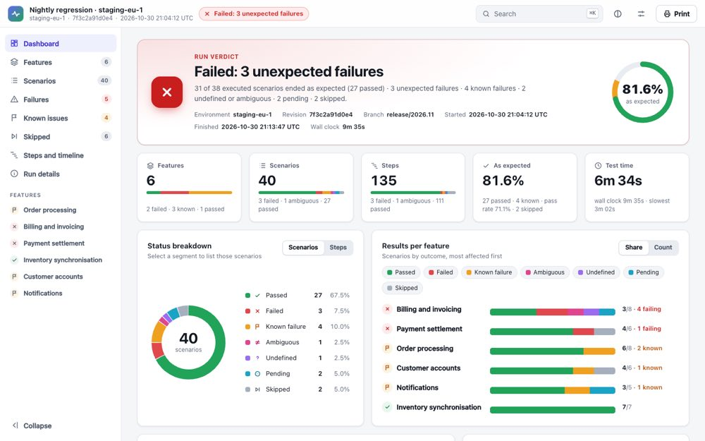
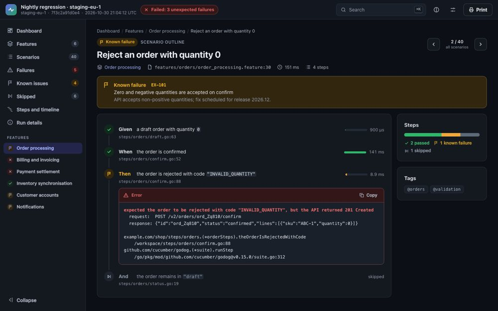

# cucumber-reporter

cucumber-reporter turns the Cucumber JSON that [Godog](https://github.com/cucumber/godog) writes
(`--format cucumber`) into one self-contained HTML report. The report works offline from `file://`,
makes no network requests, has light and dark themes, prints as a paginated document and stays
readable with JavaScript turned off.

It is a Go module with no dependencies outside the standard library.

The screenshots illustrate the original report layout; v0.3.0 adds the controls described below.



## Planned version 0.3.0 (unreleased)

Enhanced summaries use schema 4.
Plain options schema 2 and plain navigation IDs remain unchanged; see the [identity guide](docs/0.3.0.md#identity-merge-and-comparison-rules).

The existing single-run command remains supported. Optional enhanced reporting adds
merging, comparison, scoped history, retry evidence, CI gates, redaction and exports.
No historical reports are required. The UI adds investigation controls, structured
known-issue banners, advanced filters, a scenario table and selectable print scope.

See [the 0.3.0 guide](docs/0.3.0.md) for configuration, examples and compatibility.

For an oversized saved PDF, use `cucumber-report compress-pdf -quality balanced -o report-shared.pdf report.pdf`.
This optional local command requires Ghostscript, retains every page and reports the actual size reduction.
Use `-quality small` for 96 dpi images or `-quality high` to keep original image resolution.
The default timeout is five minutes; set `-timeout 10m` for a larger PDF.

## Install

```sh
go install github.com/qatoolist/cucumber-reporter/cmd/cucumber-report@latest
go get github.com/qatoolist/cucumber-reporter        # as a library
```

Go 1.27 or newer is required.

## What the report looks like

The page is an application shell: a top bar, a navigation sidebar and one view at a time.

- **Top bar.** Run name, up to three run facts, the verdict pill, Search, the theme switch, Settings
  and Print.
- **Sidebar.** Dashboard, Features, Scenarios, Failures, Known issues, Skipped, Steps and timeline,
  Run details, then a quick link per feature with its status. It collapses to icons on wide screens
  and becomes a drawer at 1024 px and below.
- **Dashboard.** The verdict with a one-line summary, the first six run facts and a ring; key figures
  (features, scenarios, steps, the headline rate and elapsed or summed step time); a status donut (scenarios or steps);
  results per feature; Needs attention; known and unexpected failures; your sections as cards; and a
  duration profile on a logarithmic scale with the slowest scenarios. Every tile, segment, bar and
  row is a link into a filtered view.
- **Features** and **Feature.** Cards with status, file, outcome bar and counts; a feature page with
  its statistics and scenario list.
- **Scenarios.** One list with a text filter (names, step text, errors), status chips, feature and tag
  selects, sorting and removable filter chips. Filters live in the URL. Lists above 150 rows are
  virtualised.
- **Scenario.** Header with previous and next within the list you came from; known-issue, skip and
  limit banners; the step timeline (arguments highlighted, duration bars, data tables, doc strings,
  errors with Copy) and attachments.
- **Failures** groups unexpected failures by error signature (identifiers, quoted values and numbers
  masked). **Known issues** groups known failures by issue key and flags issues whose scenarios
  passed. **Skipped** lists skipped and pending scenarios and observation limits.
- **Steps and timeline.** Scenarios back to back per feature (Cucumber JSON has durations, not start
  times, so the page says parallel runs appear sequential) and a sortable step-definition profile.
- **Run details.** Every run fact, every section in full, the status legend and the shortcuts.

Status is always shown by a drawn symbol and a word as well as a colour. Known failures are amber,
not red. Data text is wrapped in `<bdi>` so right-to-left text cannot reorder the page.



### Navigation and search

Every view has its own address (`#/scenarios?status=failed`, `#/scenarios/<id>?step=3`, …), so Back
and Forward work and any view can be shared as a link. Scenario and feature identifiers are stable
across renders of the same run (`report.ScenarioIDs`).

| Keys | Action |
| --- | --- |
| Ctrl/Cmd+K, `/` | Search features, scenarios, steps, tags and errors |
| `[` `]` | Previous or next scenario |
| `g d`, `g f`, `g s`, `g k`, `g t`, `g r` | Dashboard, failures, scenarios, known issues, timeline, run details |
| `?` | Shortcuts |
| Esc | Close a dialog or the drawer |

The search palette matches all words you type, ranks prefix matches first, highlights matches and
offers "Show all N matching scenarios".

### Settings

Settings holds the theme (auto, light, dark), density, start page, which attachments open by
default, and a switch for each dashboard widget and navigation section. Changes apply at once and
are saved in `localStorage` under `cucumber-reporter:v2:prefs`, per browser, over the report's
generation-time defaults. "Reset to report defaults" removes them. Saved values the page does not
recognise are ignored; when storage is blocked the page says so and keeps working.
Saved views use `cucumber-reporter:saved-views:v1` and compact overview uses
`cucumber-reporter:compact` in local storage. Same-tab list context uses
`cucumber-reporter:context:v2:<path>` in session storage. These extra keys are separate
from the preferences reset; clearing browser site data removes them.

### Print

Print (or the browser's print command) builds a dedicated A4 document: a cover with the verdict, run
facts, key figures, a status donut and per-feature bars; then failures and known issues with error
excerpts; skipped, pending and not-verified scenarios and your other sections; then every feature,
scenario and step. Pages carry the run name and verdict at the top and "Page N of M" at the bottom.
Print is always light. `#/print` shows the same document on screen. Without JavaScript the fallback
prints instead.

## Command line

```
cucumber-report [-title T] [-name N] [-options options.json] [-o parent-dir] <run-dir>
```

The command reads `<run-dir>/cucumber.json` and writes a new `<run-dir>/html-<digits>/index.html`
(or under `-o`). Every render creates a new directory; earlier reports are never replaced. On
success it prints one line, `HTML report: <path>`.

| Flag | Meaning |
| --- | --- |
| `-title` | Document title; overrides the options file. Default `Cucumber report`. |
| `-name` | Run name shown on the page; overrides the options file. Default: the title. |
| `-options` | JSON file holding `report.Options` (below), `"version": 2`. Unknown keys and trailing data are refused. |
| `-o` | Directory in which to create `html-<digits>`. Default: the run directory. |

Exit status is 0 on success, 1 when input/options/output are refused, 2 for usage errors,
and 3 when a requested enhanced quality gate fails. Reports are written before exit 3,
except `-validate`, which checks gates without writing.

Enhanced forms (see [configuration and migration](docs/0.3.0.md)):

```sh
mkdir -p reports
cucumber-report -enhanced -options options-enhanced.json -o reports shard-a shard-b
cucumber-report -enhanced -bundle -fail-on-unexpected run
cucumber-report -validate -strict run
cucumber-report -version
```

`-run-config`, `-baseline`, `-history`, `-format messages`, `-bundle` and
`-fail-on-unexpected` also enable enhanced processing for one input. `-strict`
requires `-validate` and turns parsing and run-analysis diagnostics into errors, except the informational `runner.outcome` note.

`-validate` alone checks plain-mode parsing and annotation rules without writing.
Add `-enhanced` to validate enhanced rules. `-fail-on-unexpected` enables enhanced
processing and its gate for one input. Plain generation exits 0 after successfully
writing a report even when that report shows failures.
Multiple inputs require explicit `-enhanced`. Validation ignores output-only settings
`-o`, `-bundle`, `-title` and `-name`. CLI `-options` refuses computed `analysis` and
Go-only `bundleAttachments`; use enhanced `-bundle` instead.

An options file uses the JSON names of the `report` types:

```json
{
  "version": 2,
  "title": "Checkout suite",
  "name": "Nightly regression · staging",
  "runFacts": [{"label": "Environment", "value": "staging"}, {"label": "Revision", "value": "7f3c2a91d0e4"}],
  "topFacts": ["Environment", "Revision"],
  "wallClock": "9m 35s",
  "verdict": {"label": "Passed with known failures", "tone": "warn"},
  "sections": [{"id": "known-issues", "title": "Known issues", "tone": "warn", "role": "known",
                "summary": [{"label": "Known failures", "value": "2"}]}],
  "annotations": [{"scenario": "order-processing-L30", "kind": "known", "ref": "EX-101",
                   "title": "Zero quantities are accepted", "step": 3,
                   "stepText": "the order is rejected", "observed": true}],
  "defaults": {"theme": "auto", "view": "dashboard", "widgets": {"duration": false}, "nav": {"timeline": false}}
}
```

`testdata/synthetic/showcase/options.json` is a complete example.

## Library

```go
import (
	"github.com/qatoolist/cucumber-reporter/cucumber"
	"github.com/qatoolist/cucumber-reporter/report"
)

features, err := cucumber.Parse(r, cucumber.Limits{})
ids := report.ScenarioIDs(features) // ids[i][j] names features[i].Elements[j]
dir, err := report.RenderFeaturesDirTo(features, parentDir, report.Options{
	Version:  report.OptionsVersion,
	Title:    "Checkout suite",
	RunFacts: []report.Fact{{Label: "Revision", Value: revision}},
	Verdict:  &report.Verdict{Label: "Passed with known failures", Tone: report.ToneWarn},
	Annotations: []report.Annotation{{
		Scenario: ids[0][2], Kind: report.KindKnown, Ref: "EX-101", Title: "Zero quantities are accepted",
		Step: 3, StepText: "the order is rejected", Observed: true,
	}},
})

// Or in memory:
html, err := report.Render(features, report.Options{Version: report.OptionsVersion})
```

| Function | Purpose |
| --- | --- |
| `cucumber.Parse(r, limits)` | Strict parse of Cucumber JSON into `[]cucumber.Feature`. |
| `cucumber.Validate(features)` | The completeness checks `Parse` applies, for models built in code. |
| `cucumber.Combine`, `cucumber.RunStatus` | The feature rule below, for statuses or a whole run. |
| `report.Render(features, opt)` | One HTML document as bytes. Deterministic: same input, same bytes. |
| `report.RenderDir(runDir, opt)` | Reads `cucumber.json`, writes a new `html-<digits>/index.html` in `runDir`. |
| `report.RenderDirTo(runDir, parent, opt)` | The same, creating `html-<digits>` in `parent`. |
| `report.RenderFeaturesDirTo(features, parent, opt)` | Writes already-parsed features the same way. |
| `report.ScenarioOutcomes(features, annotations)` | Each scenario's effective outcome after folding and known-issue rules (`OutcomeKnown` or its cucumber status; `OutcomeFolded` for folded Background/retry source slots, which should not be counted again), indexed like `ScenarioIDs`: the classification the report shows, for callers that need the numbers. |
| `report.FeatureIDs`, `report.ScenarioIDs` | The stable identifiers the page uses in its links and that annotations name: the slug of the feature file's base name, and `<feature id>-L<line>`, with `-2`, `-3` on collisions. |

### Options

| Field | Meaning |
| --- | --- |
| `Version` | Must be `report.OptionsVersion` (2). |
| `Title`, `Name` | Document title (also the printed brand line) and run name. |
| `RunFacts` | Label and value pairs: the first six on the dashboard, all under Run details and on the printed cover. |
| `TopFacts` | Up to three `RunFacts` labels shown in the top bar. Default: the first three facts. |
| `WallClock` | Measured elapsed duration, shown as the primary dashboard and print time. Summed step time remains separate. Surrounding whitespace is trimmed; an empty value shows only summed step time. Cucumber JSON has no start times, so the renderer cannot compute elapsed time. |
| `TimingSection` | Optional ID of an existing `Sections` entry. Links the dashboard time card to that section under Run details. Without it the card opens the slowest-scenarios list. A missing section ID is rejected. |
| `Verdict` | The headline: `Label` (required) and `Tone` (`ok`, `warn`, `fail`, `info`; empty uses the computed tone). Without it the headline is computed (an empty execution says "No scenarios executed"; retries append "(N flaky)"; failed gates can say "Failed: quality gate (…)" ): "Failed: N unexpected failures" (N counts scenarios whose outcome is failed after the known-issue rules), Ambiguous or Undefined (fail), Passed with known failures (warn), Pending or Skipped (info), Passed (ok). |
| `Sections` | Your own panels: a card on the dashboard and a full panel under Run details. `ID` is a-z, 0-9 and `-`, starting with a letter, at most 48 characters; `Tone` is `info` (default), `ok`, `warn` or `fail`; `Summary`, `Rows` and `Note` hold the content. `Role` tells the page what the section summarises: `known` (its summary and note appear on Known issues instead of a dashboard card; at most one), `skip` or `limit`. Sections with a role are left out of the printed scope sections, because their entries print from the annotations. |
| `Annotations` | Caller knowledge per scenario, named by `ScenarioIDs`: `Kind` `known` (with `Ref`, the issue key), `skip` (why a scenario was skipped) or `limit` (not fully verified in this environment), plus `Title` and `Note`. See Known issues below. |
| `Defaults` | Generation-time view settings: `Theme` (`auto`, `light`, `dark`), `Density` (`comfortable`, `compact`), `Expand` (attachments open at load: `failed`, `all`, `none`), `View` (start page: `dashboard`, `features`, `scenarios`, `failures`), `Widgets` and `Nav` (an entry `false` hides a dashboard widget or navigation section; `report.Widgets` and `report.NavSections` list the keys; the dashboard cannot be hidden). |
| `Limits` | `Input` (default 512 MiB), `Embedding` (base64 characters per attachment, default 64 MiB; enforced before decoding by `Parse` and by every render function, including for models built in code) and `InlineAttachment` (default 4 MiB). |

Errors are sentinel values for `errors.Is`: `cucumber.ErrNoResults`, `ErrInvalidJSON`,
`ErrIncomplete`, `ErrInvalid`, `ErrTooLarge`, `ErrInvalidBase64`, and `report.ErrOptionsVersion`,
`ErrInvalidOptions`, `ErrNoInput`, `ErrNotRegular`, `ErrEmptyOutput`. Messages name a field, index or
location, never input content.

### Elapsed time and phase details

Set `WallClock` to the measured run duration to show it as the primary dashboard
and print time. Summed step durations remain a separate secondary metric because
concurrent steps can overlap. When elapsed time is unavailable, leave `WallClock`
empty: the card is labelled "Summed step time" and does not repeat that value in
its secondary text. The reporter never estimates setup time from summed steps.

Set `TimingSection` to an existing custom section ID to link the time card to your
measured phase breakdown. Without that option the card opens the slowest-scenarios
list, as in earlier versions.

### Known issues

The renderer applies these rules, so a caller passes its records without post-processing. A known
issue covers only its declared step; any other unexpected result still fails.

- One `known` annotation per scenario and issue key; a repeat is refused.
- `Step` is numbered from 1 over the original scenario `steps[]` in plain mode (including
  cucumber-js inline hooks). Enhanced mode numbers only scenario-owned steps. `StepText` is that
  step's text (without the keyword); the two go together. When the scenario's step at `Step` has a
  different text, the record is shown with a warning ("not applied") and covers nothing, so a
  numbering slip cannot hide a failure.
- `Observed` says that an expected-failure outcome was recorded at the declared step; it needs `Step`.
- A failed scenario is a **known failure** only when its first failed step is a declared step. A
  failure at an earlier or a later step, or a record without a declared step, leaves it an
  unexpected failure (red); the record is shown beside it as context, with the reason.
- A passed scenario with an observed declared step is a known failure (the expected failure was
  recorded while the step itself passed). A passed scenario whose issue was not observed stays passed
  and is flagged "the issue may be fixed", unless every outcome of the record has `NotApplicable`
  set (its condition lay outside the run's scope): then it reads "not applicable in this run".
  Ambiguous, undefined, pending and skipped are unchanged.
- A record that covers nothing (not applied, or invalid) never counts as a known issue: the Known
  issues page lists it separately under "Records not applied" with its reason, the dashboard notes
  it apart from the known-issue list, and print lists it with its reason. The renderer decides each
  record's state once and the page, the fallback and print all use it.
- The known-failure marker sits on the declared step only. `Outcomes` (every recorded outcome) are
  listed in the scenario banner as detail and never mark a step; the declared one is labelled.
- With known failures the headline figure is "As expected" (passed plus known, over executed
  scenarios) with the raw pass rate beside it, on the dashboard, the ring and the printed cover.

## Status rules

- A scenario takes the most severe step status: failed, ambiguous, undefined, pending, skipped,
  passed. A scenario without steps is undefined, as Godog counts it.
- A feature, and the computed headline, is failed, ambiguous, undefined or known failure if any
  scenario is (in that order); pending only when every scenario is pending; skipped only when every
  scenario is skipped or pending; otherwise passed. A skipped scenario beside passed ones leaves the
  run passed.
- This is multiple-cucumber-html-reporter's feature rule, kept deliberately: a feature with five
  passed scenarios and one skipped one shows as passed (green), and its skipped scenario still
  counts and shows as skipped in every list, chart and count. Only an all-skipped feature is skipped.

## Attachments

Attachments travel as their base64 text when the decoded content fits `Limits.InlineAttachment`.
JSON opens as a collapsible tree or raw text, other text as text (HTML is never rendered as markup),
PNG, JPEG, GIF and WebP as images; anything else shows its type and size with Save. Copy and Save
work on every inline attachment, an empty one included. Raw and Copy always give the original text
byte for byte; only the tree shows values as JavaScript parses them, so a large integer, `1e400` or a
repeated key reads differently there (the page says so). Larger text and JSON attachments are written beside the report as
`attachment-….txt` or `.json` by the directory functions and linked; `Render` leaves them out with a
note, as it does larger binary attachments.

## Security model

The report shows test output, which may contain anything. It is built so that this content can
never act as markup, style or script:

- The data reaches the page in one `<script type="application/json">` block produced by
  `encoding/json` with HTML-safe escaping (`<`, `>`, `&`, U+2028 and U+2029 become `\u` escapes), so it
  cannot close the element. The page script reads it with one `JSON.parse` and builds every node with
  `createElement` and `textContent`; it never uses `innerHTML`, `eval` or inline handlers, and sets
  geometry through SVG attributes or CSSOM, never `style` attributes. A unit test refuses markup- and
  code-parsing APIs in the embedded script, and a browser test renders hostile strings into every
  field and checks every view for elements, attributes, links or dialogs made from them.
- One piece of data does reach a stylesheet: for the printed page header the script inserts one
  `@page` rule through CSSOM whose `content` values are the run name and the verdict label, written
  as CSS strings (backslash and double quote escaped, control characters replaced by spaces). A
  browser test decodes them back from the live rule and compares them with the data.
- The no-JS fallback is rendered by `html/template`. The code never converts data to
  `template.HTML`, `template.JS`, `template.CSS` or `template.URL`.
- The page carries a Content-Security-Policy: `default-src 'none'`, the inline stylesheet and the
  inline script allowed only by their SHA-256 hashes (computed at start-up from the embedded minified
  files), `img-src data:`, `base-uri 'none'`, `form-action 'none'`, `object-src 'none'`, and a
  `no-referrer` referrer policy. No `unsafe-*` source is used. The data block needs no hash because it
  is not executed.
- Links are built only for routes within the page and for attachment files whose names the renderer
  chooses. Links in the data are shown as text.
- `RenderDir`, `RenderDirTo` and `RenderFeaturesDirTo` write directories with mode 0700 and files
  with mode 0600 (`O_EXCL`). They write into a temporary directory that is then renamed, never
  overwrite, and write nothing outside the output directory. They refuse a `cucumber.json`, run
  directory or output directory that is a symbolic link, however the path is spelled (`link`, `link/`,
  `link/.`), and check that the `cucumber.json` they open is the regular file they inspected. The
  command applies the same checks to the `-options` file.
- Error messages never include input content.

Redaction is off by default. The enhanced pipeline supports explicit redaction and attachment
exclusion policies; see the 0.3.0 guide. Existing rendering APIs preserve supplied content.

## Browser support

The page needs Chrome or Edge 123, Firefox 120 or Safari 17.5 or newer, because each colour is
defined once with CSS `light-dark()`. Page headers and footers in print use CSS page-margin boxes,
which Chrome and Edge 131 or newer support; other browsers print without them. Without JavaScript any
browser shows the static fallback. The automated checks run in headless Chrome; the development-only CI matrix also checks Firefox and WebKit. WebKit checks do not
replace testing in the Safari application.

## Sizes

Attachment-free output budgets are enforced by `TestReportSizeBudget` (see the 0.3.0 guide). The readable
`report/assets/app.js` and `app.css` are minified by `go generate ./report` (a dependency-free,
conservative minifier in `internal/minify` that removes comments and whitespace and never renames
identifiers) into the committed `.min` files that are embedded. Historical measurements from 0.2.0 (0.3.0 has additional investigation controls):

| Item | Readable | Embedded (minified) | Minified, gzip |
| --- | --- | --- | --- |
| `app.js` | 107,813 B | 86,107 B | 27,818 B |
| `app.css` | 58,245 B | 49,704 B | 11,095 B |
| Report of one feature with two steps | | 138,325 B | 39,878 B |
| Report of 5,000 steps (1,000 scenarios) | | about 1.6 MB | |

Attachments dominate larger reports: an attachment costs about 1.03 times its base64 size.

## Limits

- Input: supported Cucumber JSON or Messages (see the runner matrix below). Every step needs one of
  `passed`, `failed`, `skipped`, `pending`, `undefined`, `ambiguous`. Duplicate keys and data after the
  array are refused. Non-passing scenario/step hooks and their evidence are retained;
  passing-only hooks preserve the historical plain output. Standalone Background
  results fold into the following scenario. Orphan Backgrounds produce a diagnostic and count
  as no scenarios. Unknown non-execution fields are ignored.
- Godog's JSON does not carry Scenario Outline example values separately; outline rows appear as
  scenarios with their substituted names.
- The legacy command renders one run. Optional enhanced processing merges shards and embeds supplied history.
- Full print includes all scenarios. The Print dialog can select a smaller scope.
- Parsing, model conversion, redaction and the embedded data can require substantially more
  memory than the input (large generated suites have exceeded 10×). Lower `Limits.Input` where
  memory is tight. Directory output streams HTML to disk; the CLI warns above 200 MiB.
  Beyond 1,000 scenarios, the static no-JavaScript fallback retains all problem details
  but limits passed details. JavaScript, exports and explicitly selected full print retain all results.
- The symbolic-link checks apply to `cucumber.json`, the `-options` file and the final element of the
  run and output directory paths, after the path is cleaned; links in parent directories are followed.

## Runner formats

| Runner | Input | Coverage and limits |
| --- | --- | --- |
| Godog | Cucumber JSON | Captured Godog fixture plus synthetic regressions |
| cucumber-jvm | Cucumber JSON | Runner-shaped fixtures cover Backgrounds, hooks, logs, timestamps and retries |
| cucumber-ruby | JSON / Messages | Captured 9.2.1 `--retry` JSON and Messages; logs, step hooks and retry outcomes verified |
| cucumber-js | JSON / Messages | Runner-shaped fixtures cover inline hooks, arguments and attachments; captured legacy base64 text still needs confirmation |
| Reqnroll | Cucumber JSON | Runner-shaped fixtures cover hooks and durations |
| pytest-bdd | Cucumber JSON | Runner-shaped fixture coverage |
| behave | — | Its different JSON structure and floating-point seconds are refused with a specific diagnostic; convert upstream |

Fixture coverage is not a certification of every runner version. Unknown execution metadata
is reported by `-validate`; `-strict` makes those diagnostics fatal. Missing history and
baseline files are optional unless a requested comparison gate needs a baseline.

For a Godog project, a minimal local run is:

```sh
mkdir -p run
godog --format cucumber:run/cucumber.json
cucumber-report run
```

On Windows, use the same commands in a shell with Go on PATH. PDF compression looks for
`gswin64c.exe` / `gswin32c.exe`; set `GS` to the executable if it is outside PATH. Go's
portable writer syncs files before publication; Windows does not provide the Unix directory
fsync guarantee. `CHROME` selects a browser for developer checks, and `CHROME_FLAGS`
adds trusted local launch flags (never report content).

## Development

```sh
make verify          # gofmt check, go vet, golangci-lint, go test -race
make generate        # re-minify report/assets after editing app.js or app.css (a test fails otherwise)
make fuzz-smoke      # each target for FUZZTIME (default 30s); minimization capped at 1s
make browser-check   # interaction, print and stress checks in local headless Chrome; the PDF checks
                     # need Ghostscript (gs). Not part of verify, because it needs both.
make ui-check        # Playwright UI checks (routes, print preview, reflow, retries, settings, history,
                     # mobile drawer, evidence, palette, attempt times, empty report) and their mutant proofs; chromium by default,
                     # BROWSERS="chromium firefox webkit" for all three (CI runs all three).
                     # Needs `pip install -r internal/browsercheck/requirements.txt` and `playwright install`.
make golden-update   # rewrite expected HTML after an intended change; review the diff
```

Linting needs golangci-lint v2 built with Go 1.27 or newer; a binary built with an older Go stops
with "the Go language version ... is lower than the targeted Go version". Set `GOLANGCI_LINT` to
choose the binary, for example `make verify GOLANGCI_LINT=/path/to/golangci-lint`.

A checkout inside a directory tree that has a `go.work` file (for example a workspace that also
holds a project using this module) is built as part of that workspace, and the `make` targets can
then fail on the workspace's other modules. Run them with `GOWORK=off`, for example
`GOWORK=off make verify`.

`testdata/synthetic/godog-v0.16.0.json` and `godog-v0.16.0-stepless.json` are real Godog v0.16.0
output for invented features; `testdata/synthetic/godog-gen` regenerates them.
`testdata/synthetic/showcase` is an invented run with known issues, skips and observation limits,
in a failed and a passed-with-known-failures variant, used by the golden, CLI and browser tests.

## Licence

MIT; see [LICENSE](LICENSE). The status semantics follow multiple-cucumber-html-reporter; see
[NOTICE](NOTICE).

### Cucumber Ruby

For captured cucumber-ruby 9.2.1 output, prefer Messages:

```sh
cucumber --format message --out run.ndjson
cucumber-report -enhanced -format messages -fail-on-unexpected run.ndjson
```

The reporter supports both captured Ruby retry shapes, with and without Backgrounds.
A failed attempt is rescued only by a strictly passing final attempt; pending or skipped
final attempts do not erase a failure. Passing retried scenarios are marked flaky.
The original attempts and their evidence remain available. Unconfirmed duplicate
executions from other runners are not assumed to be retries.

Pending beside passed follows Cucumber's default and can produce a passing report;
undefined or ambiguous outcomes remain non-green. JSON has no runner exit-status signal.
To enforce strict pending behavior with JSON, use `-run-config` with
`{"gates":{"pending":true,"undefined":true}}`. Messages preserves
`testRunFinished.success:false`, including `--strict` and `--strict-flaky`, as a
non-green “Runner reported failure” even when final scenarios passed.

Runner git branch/revision values are displayed as facts. Only explicitly configured
scope values separate baseline comparisons and history environments.


For v0.3.0 outcome rules, optional pending/flaky/empty gates, disjoint shard inputs,
empty-run handling and attachment sharing limits, see [the outcome and evidence
rules](docs/0.3.0.md#outcome-retry-and-evidence-rules-in-v030). Gate failures appear
in both the report verdict and the CLI exit status.


Repeated scenario locations across inputs are refused in v0.3.0. The diagnostic
lists the first 20 collisions (bounded to 4 KB), followed by the remaining count and its input names. Disjoint shards remain supported with
`-enhanced`; retries inside a single JSON or Messages input remain supported.
For reruns or browser/OS matrix cells, generate one report per run or cell, or use
the runner's `--retry` within a single run. This rule also applies to `-validate`
and the `PrepareRun` library API. See the [v0.3.0 guide](docs/0.3.0.md) and
[0.3.1 roadmap](docs/0.3.1-roadmap.md).
